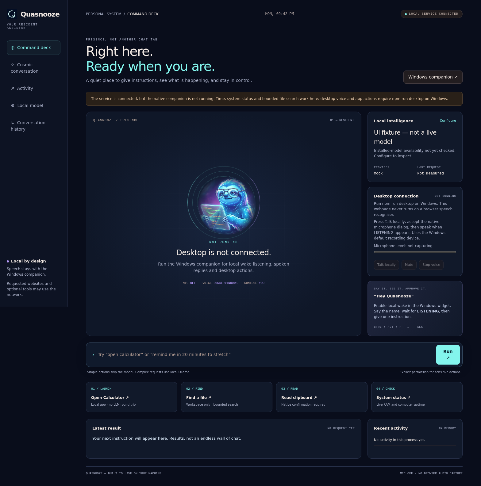

# Pinch resident assistant — Windows preview

Pinch's desktop mode is a **resident Windows host**, not a browser speech API wrapped around chat. A small always-on-top widget and notification-area icon stay available while Pinch runs. The command deck is its control surface; closing the browser does not stop the native host. Closing the widget hides it; **Quit Pinch** in the tray exits the assistant.

**Validation boundary:** Node tests and browser checks have run on Linux. The native C# source also compiles as C# 5 against Microsoft's .NET Framework 4.8 reference assemblies. The Windows PowerShell compilation/self-test job is supplied in CI, but Windows execution, microphone recognition, audio-device switching, login startup and hotkey behavior have **not yet been verified on real Windows hardware**. This is a reviewable preview, not a claim of production-ready Jarvis or control of every application.



This screenshot uses a **mock brain**, with **no native host or installed model**. Its clock result is real; its 1 ms value measures that clock handler, **not model inference, wake recognition or end-to-end voice latency**.

## Start on Windows

Requirements:

- Windows 10/11, Node.js 22+, Windows PowerShell 5.1 and .NET Framework 4.8 with WinForms/System.Speech. No Python, browser speech SDK or cloud audio account is required. Restricted execution policies may prevent launching the helper; Pinch does not change machine policy or bypass organisational controls.
- A microphone and a compatible **English desktop System.Speech recognizer** for voice. Pinch prefers en-IN, then en-US, then another installed English recognizer. Modern Windows voice-access support alone does not prove that the classic desktop recognizer is installed. If none is available, use typing and install the appropriate English speech components in Windows Settings before restarting. There is no silent browser/cloud fallback.
- For general reasoning, a working loopback Ollama installation and an installed model. Native quick actions do not require a model. Hardware/model size determine inference speed; no universal RAM requirement or response-time promise is made here.

From the repository directory:

```powershell
npm run setup
npm run doctor
npm run brain
npm run desktop
# Equivalent CLI: node bin/pinch.js desktop
```

Do not leave a separate `npm start` instance listening on the same port. Setup accepts either an installed model's name or its listed number: `1` now resolves to the first installed name, not a model literally named `1`. Choose a model that actually appears in `ollama list`; the deck can switch among locally installed selections.

Desktop launch binds the service to **127.0.0.1**, creates a random process-lifetime key if none was configured, and forces broad auto-approval **off**, without rewriting `.env`. Existing workspace/tool protections and individual approval rules still apply. Read-only tools may run without confirmation according to the existing risk tiers; this is not an OS security sandbox.

### Daily use

1. Use **Enable local wake** in the widget. A default-No consent dialog explains the microphone and nearby-speaker risks. Every restart starts muted.
2. Say **Hey Pinch**, pause until **LISTENING**, then say one instruction. This first implementation is a two-stage local grammar plus dictation recognizer, **not** an acoustic neural wake-word engine and not continuous free-form conversation. Accuracy depends on microphone, noise, speech pack and accent.
3. Alternatively use **Talk**, **Ctrl+Alt+P**, the widget text field, or the command deck. A hotkey conflict is displayed rather than silently claimed as registered.
4. **Mute microphone** releases recognition. **Stop voice** cancels speech, but does not cancel a running action or turn off armed wake listening. The mic pauses while working or speaking, to reduce self-triggering.
5. Open the tray's **Toggle start with Windows** only if wanted. The confirmation changes just your user's `Startup/Pinch.lnk`; using it again removes that shortcut. It does not add an administrator service, change machine policy, or enable the microphone on login. Keep Node and the repository at their configured paths.

The first run compiles the native host through PowerShell; it is not yet an installer or single signed executable. A console may remain visible/minimised with the Node process.

## What actually works in this implementation

| Request/control | Route and boundary |
|---|---|
| `what time is it` | Local clock, configured timezone, no model |
| `system status` | Actual free/total RAM and **computer** uptime, no model; not CPU/GPU telemetry |
| `open calculator`, `open notepad`, `open file explorer` | Fixed native app allowlist, no executable guessing or model call |
| `open github`, `open youtube`, `open google`, `open https://example.com/` | Credential-free HTTPS only, exact address shown in a default-No native confirmation; the requested website uses the network |
| `find README` | Filename-only configured-workspace search: at most 2,000 entries, four levels, 20 matches, about a second of traversal budget; hidden entries, symlinks and protected paths excluded. Filesystem I/O can exceed the traversal budget. Not full-disk indexing or content search |
| `read my clipboard` | Native default-No confirmation before reading; returned text is not inserted into model history by this action. It may be spoken aloud and displayed to key holders, so do not use it for secrets |
| `remind me in 20 minutes to stretch` | Persistent reminder, delivered through the running desktop host. Must be running, awake and connected; not an alarm service or guaranteed delivery. A reminder received while a request/approval is active waits until that request finishes |
| General questions/tasks | Existing agent using loopback Ollama (or explicitly configured canned mock); remote/OpenAI selections refused for resident requests. Existing tools, workspace limits and per-action approvals apply |
| Approve / deny | Explicit button against the exact current desktop approval ID; spoken `yes` cannot approve. Native Allow reconfirms the full action, default No; long descriptions require the deck |

Without a native host, the deck still supports clock, system status and bounded search, and says that native voice/app/reminder delivery is unavailable. It does not simulate an installed assistant. The default web home is the command deck; the existing chat remains at **Conversation history** (`/index.html`) for normal web/channel conversations. Non-Windows users can keep using that existing surface; the resident host itself refuses non-Windows launch.

**Not implemented:** arbitrary desktop clicking/typing, universal application automation, screen/vision understanding, mail/calendar integrations beyond existing project tools, OS shutdown/reboot, speaker identification, offline weather knowledge, an interruption/cancellation protocol for running tools, a neural wake-word pipeline, or a signed auto-updating installer. Do not give Pinch elevated privileges or assume a wake phrase authenticates a person.

## Speed: changes, not invented benchmarks

- Deterministic everyday intents bypass the LLM. Both tests and the real HTTP clock interaction exercise this route.
- Ollama requests set `think: false` by default, avoiding hidden reasoning on models that support that setting. Set `OLLAMA_THINK=true` only when the extra reasoning/latency is wanted. Unsupported or older model/server combinations may need upgrading or a different model.
- Setup resolves numeric model choices; the deck lists actual installed names rather than claiming readiness from a selected string alone.
- Transport failures are marked in stored assistant messages and omitted from future model prompts, including the legacy unreachable-error prefix. This prevents a recovered model from being primed to repeat an old runtime failure.
- Model POSTs cannot follow redirects to another endpoint.

`ms` in the activity panel is **server request completion time**, not time-to-first-token or wake-to-speech latency. Cold loading, CPU-only inference, a large model, long context and tool calls can still be slow. Use `npm run brain` on the target PC; compare cold and warm requests using the same model and prompt. No real Ollama inference benchmark or audio latency measurement was possible in the Linux validation environment.

## Privacy and architecture

```text
Windows System.Speech / typed widget
          ↕ private stdin/stdout JSON-lines (no native HTTP executor)
Node Windows bridge → resident runtime → local fast path / scoped approval / agent
          ↕ existing authenticated, Host/Origin-checked service
                command deck
```

- `desktop/Companion.cs`: WinForms widget, tray, local recognition/TTS, fixed native actions. `desktop/windows.ps1` compiles it; `desktop/startup.ps1` handles the per-user shortcut.
- `src/windows-companion.js`: child lifecycle, minimal child environment (no model/messaging credentials), UTF-8 stream decoding, bounded replies and expiring action IDs. Clipboard/URL confirmations are rechecked for expiry before acting.
- `src/desktop.js`: serial resident request session, bounded file finder, local-model boundary, current-session approval IDs, queued reminders. Disconnect denies a pending desktop approval.
- `/api/desktop`: authenticated GET snapshot and POST **one** command, control or approval. It cannot start the native host. Cookie-only API authentication remains refused; foreign Origin/Host protections remain in force.
- `public/desktop.html`: no external runtime libraries and **no browser microphone API**. Dynamic text uses text nodes. Service loss marks microphone state **UNKNOWN** and tells you to check/mute the native tray; a disconnected page cannot prove that a still-running native microphone is off.

The native component neither saves audio nor intentionally sends it to a cloud speech service. Recognized text used for general requests enters the **existing local agent/session storage**, and reminders persist in Pinch's data directory. Fast-path recent commands/results remain in runtime memory; clipboard results are displayed in the authenticated deck and may be spoken. Existing optional tools, websites, remote MCP servers and messaging integrations have their own network/data boundaries. **Local speech is not a promise that every tool stays offline.** Only use trusted model endpoints/tools and keep the service key private.

The key is initially passed to the browser URL by the native Deck action; the page removes it into tab-local sessionStorage. Browser history, extensions, local process inspection and local malware are outside this application's security boundary. A key holder is a trusted operator, not a low-privilege tenant.

The older chat page's optional browser speech feature is separate: it now requires fresh consent and warns that the browser vendor may process audio. It does **not** satisfy the local wake requirement and is never started by the command deck.

## Jarvis review: what was useful

The user supplied [GitHub's Jarvis repository search](https://github.com/search?q=jarvis&type=repositories&s=stars&o=desc). Public pages were inspected as architecture references, not executed or copied:

- [microsoft/JARVIS](https://github.com/microsoft/JARVIS) is a research/tool-orchestration umbrella, not a drop-in always-present Windows assistant. Its popularity does not establish relevance to this desktop requirement.
- [OpenJarvis](https://github.com/open-jarvis/OpenJarvis) exposes a native desktop directory and Windows build work. The useful direction is a resident native shell plus local services, rather than treating a chat tab as physical presence; no implementation parity is claimed.
- [Priler/jarvis](https://github.com/Priler/jarvis) describes a Rust/Tauri desktop architecture, local STT and several wake approaches, but its README explicitly warns it is outdated and lists unfinished components. It is not evidence that every listed feature works.

The resulting Pinch choices are its own: native Windows resident shell, session-only mic consent, visible state/mute, deterministic quick actions, scoped confirmations and a command deck using the existing identity. No source, logo or performance claim was copied from these projects.

## Reproducible checks

```powershell
node --test
node scripts/audit.js
powershell.exe -NoProfile -STA -ExecutionPolicy Bypass -File desktop/windows.ps1 -CheckOnly
```

The last command compiles and checks URL policy without opening a widget or microphone. CI adds that command on `windows-latest` plus desktop orchestration/HTTP tests. CI cannot establish real microphone accuracy.

For optional browser regression checks, install Playwright **as developer tooling outside runtime dependencies**, install its Chromium browser, then run `scripts/check-desktop-ui.cjs` against a disposable, loopback mock service with **no native host or Ollama**. Set `NODE_PATH` to that tooling's `node_modules`, `PINCH_UI_BASE=http://127.0.0.1:7777/`, and optionally `PINCH_UI_SCREENSHOT` to an output PNG. The script covers actual clock calls, disconnected native state, missing model, dialogs, four widths, and a **separate synthetic** text-injection response. Synthetic injection data is never used in the screenshot.

### Required Windows acceptance pass before calling this release-ready

- Compile with Windows PowerShell; start, hide/show, quit and relaunch the tray/widget.
- Verify mic off at launch/login; opt in, wake → listening → one request → pause/TTS → armed; verify mute releases the microphone and no recognition happens during work/speech.
- Test missing recognizer, denied permission, device unplug/switch, noise/false activation, en-IN/en-US recognition and hotkey collision.
- Confirm exact URL/clipboard consent, cancellation, 30-second expiry, sensitive tool approval, denied action, long description, disconnect and concurrent reminder.
- Verify startup install/remove affects only the user's Pinch shortcut and starts muted after login; verify no process remains after tray Quit.
- Measure cold/warm Ollama completion and wake-to-listen / command-to-speech on named PC hardware. Do not reuse a clock-handler timing as an inference benchmark.


## Troubleshooting: chat microphone works, command-deck Talk does not

These are different engines: the chat browser recognizer may use a vendor service;
the command deck uses local Windows System.Speech and the **Windows default recording
device**. Browser success does not validate desktop-app microphone permission, that
default device, or classic English desktop recognition accuracy.

1. If the deck says connection needed, keep the `npm run desktop` process running
   and use **Deck** in the native widget to reopen the correct server/key. Do not
   open desktop.html as a `file://` page. Verify the clock fast path before testing
   speech. A page losing its API connection cannot establish native mic state.
2. Press Talk locally and accept the default-No native consent dialog. The widget
   is brought forward for consent; wait for LISTENING. Check Windows Settings >
   Privacy & security > Microphone > allow desktop apps, and System > Sound > Input.
   The browser can be using a different device. Check the selected input meter.
3. Read **Last speech event** in the deck: listening/hearing, rejected or
   low-confidence input, initial-silence timeout, input-signal problems and engine
   errors are now surfaced instead of silently returning to wake mode. Recognized
   text and confidence are local runtime diagnostics, not a cloud STT fallback.
   Rejected text is not executed. Historical diagnostic text is not a live mic LED.
4. Try `what time is it`, which bypasses the model. Only then test model requests;
   request completion time does not measure recognition latency.

The completion handler now rearms wake listening after a natural multiple-mode
completion too, rather than assuming only dictation can complete. Device-specific
failures and recognition quality still require a Windows microphone test; these
changes do not establish the cause on an unseen user's computer.

### Deeper voice review and diagnostic

See [VOICE-REVIEW.md](VOICE-REVIEW.md) for the full pipeline review, cancellation /
replacement fix, executable native lifecycle checks, and evidence limits.
`npm run desktop:doctor` lists prerequisites without recording;
`npm run desktop:doctor -- --self-test` probes recognition using synthetic WAV
without microphone access; `npm run desktop:doctor -- --mic` separately asks
permission for a short real input test and never executes the transcript.

### Natural replies and optional follow-ups

See [CONVERSATION.md](CONVERSATION.md) for the agent/output review. The native tray
now offers **Conversational follow-ups (local)** with explicit session-only
consent: after a spoken response it listens for another instruction for up to 12
seconds without repeating the name. Silence returns to wake mode. It is still
half-duplex; spoken output starts after the final answer, and there is no promise
of simultaneous speaking/listening or measured real-model latency.
